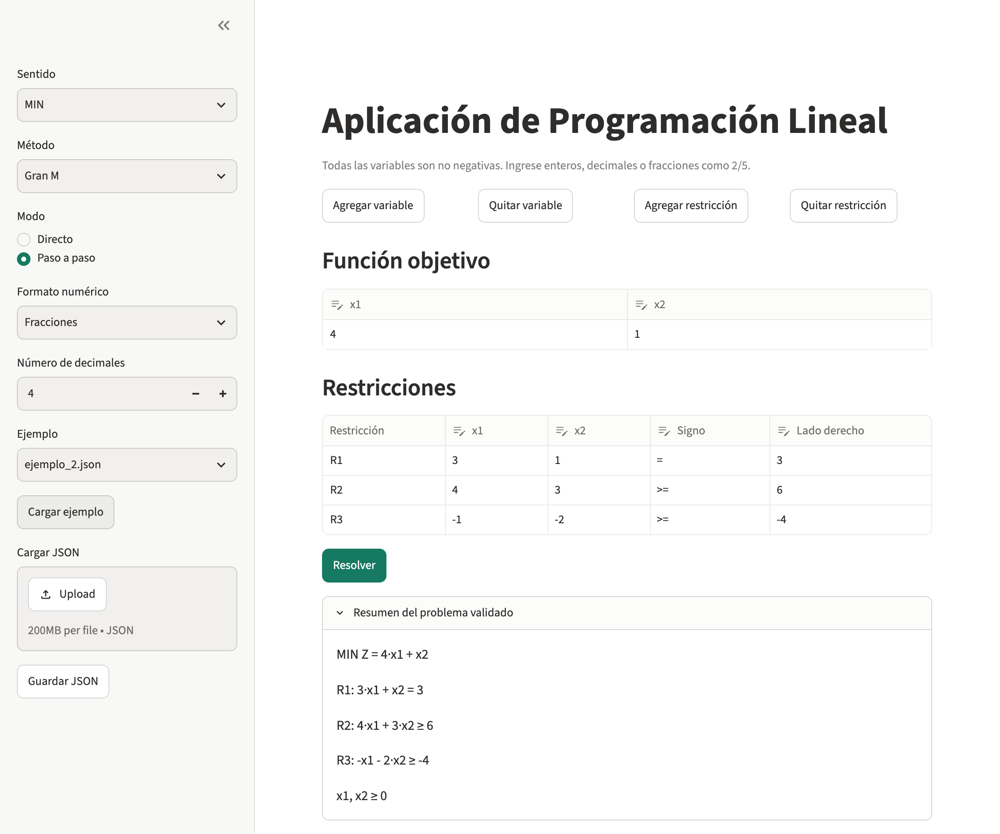
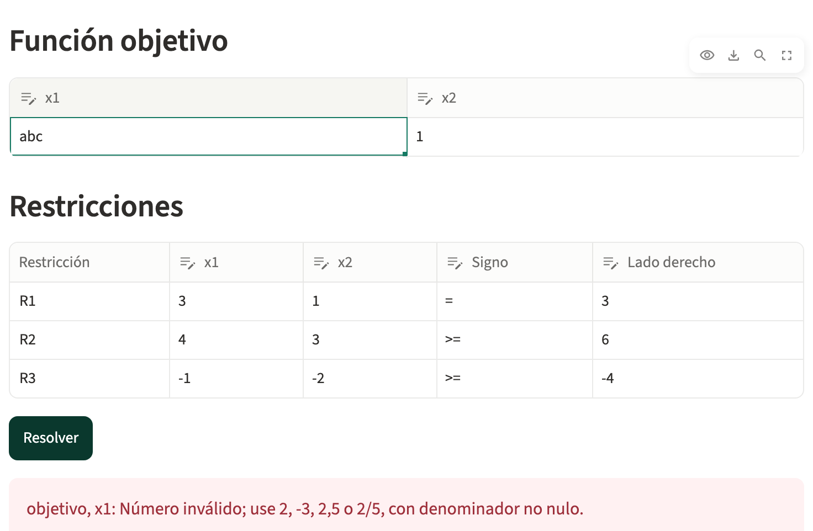
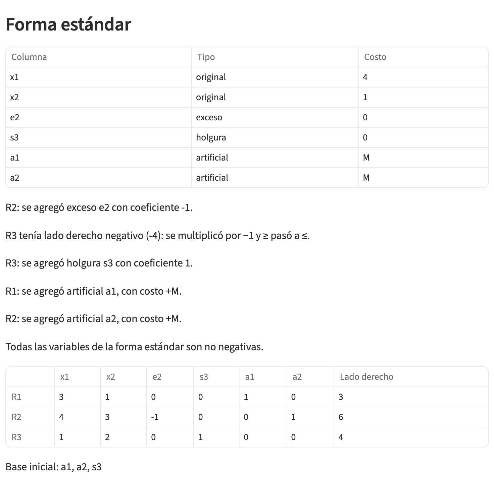
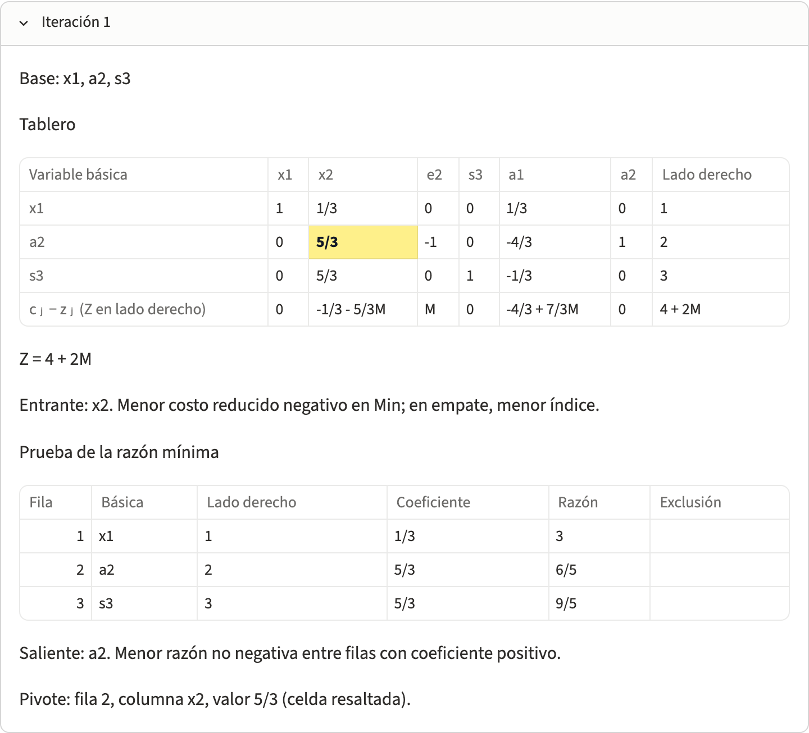
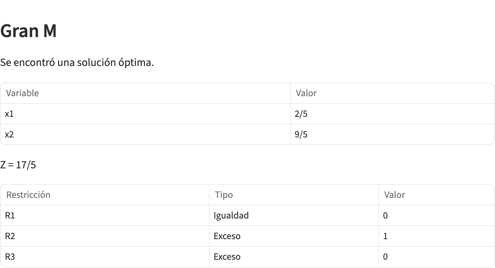
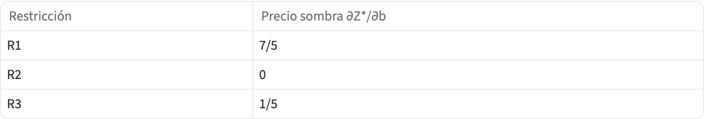
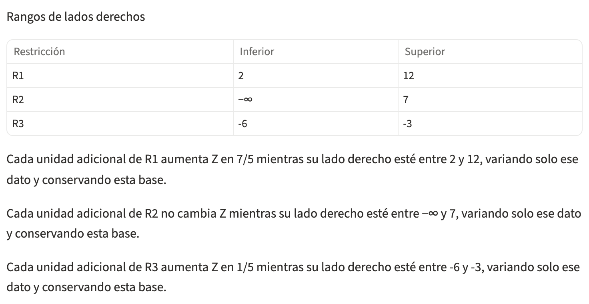
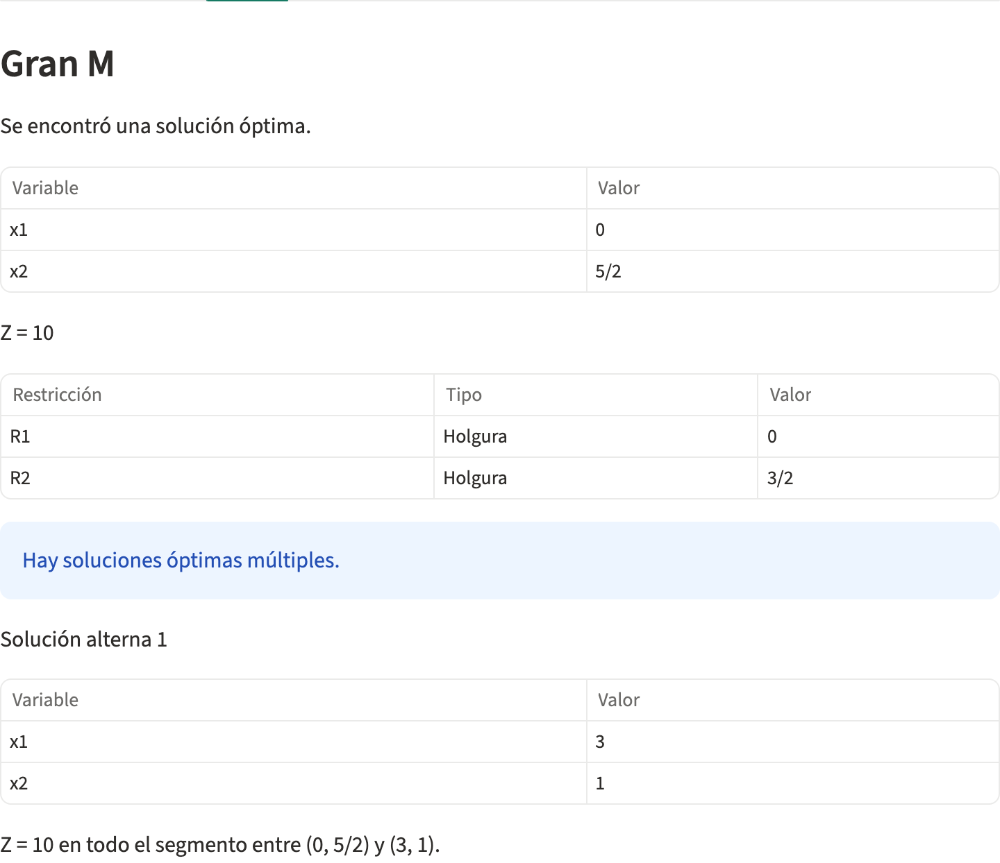
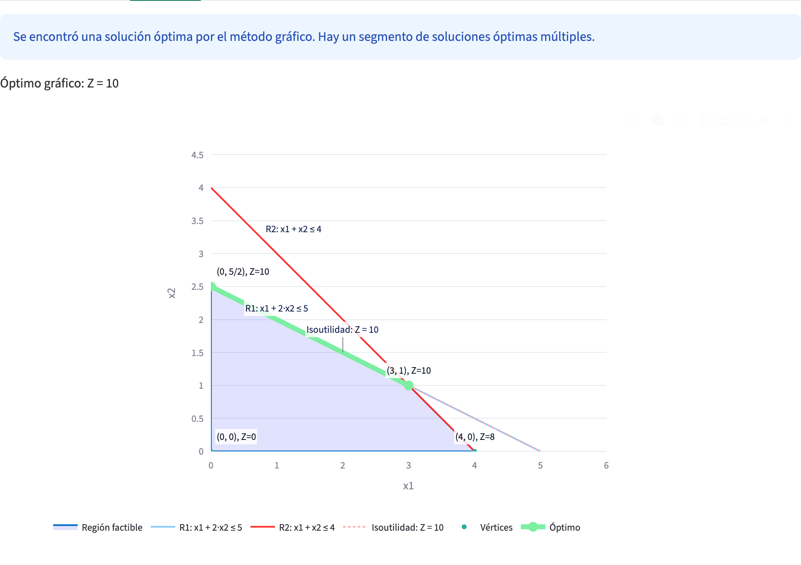
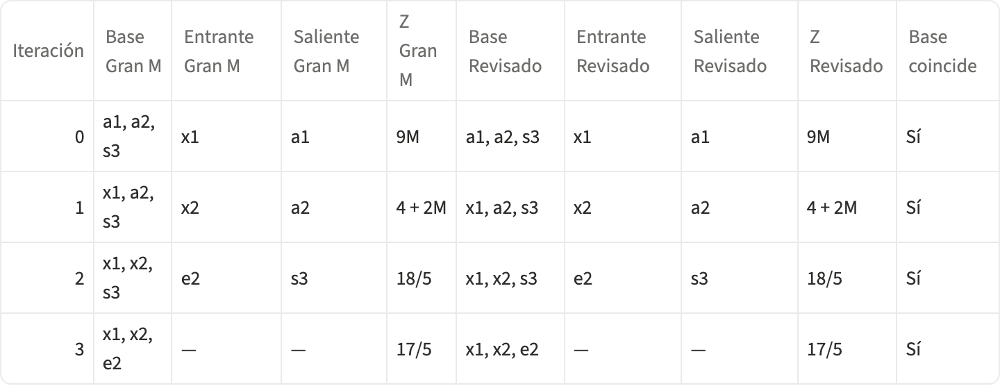

# Manual de usuario: Aplicación de Programación Lineal

Universidad de Antioquia, Optimización. Equipo: Diego Armando Muñoz Carvajal,
Jhordy Calle Henao y Julio César Buitrago Yépez.
La versión impresa de este manual es `docs/manual/manual.pdf` y se genera con
`make manual`. Todas las capturas provienen de la aplicación en ejecución y se
toman con `make manual-captures`.

## 1. Acceso

- **En línea (Streamlit Community Cloud):** [por completar].
- **En el computador:** instale [uv](https://docs.astral.sh/uv/) y, desde la
  carpeta del repositorio, ejecute `uv sync --locked` y luego
  `uv run streamlit run app/streamlit_app.py` (o `make setup` y `make run`).
  Abra `http://localhost:8501`. Detenga la aplicación con Ctrl-C.

## 2. Formular un problema

1. En la barra lateral, elija el **Sentido**: MAX o MIN.
2. Use **Agregar variable**, **Quitar variable**, **Agregar restricción** y
   **Quitar restricción**. Las celdas que siguen existiendo conservan su valor.
3. En **Función objetivo**, escriba un coeficiente por variable.
4. En **Restricciones**, escriba los coeficientes, el **Signo** (`<=`, `>=`
   o `=`) y el **Lado derecho**, que puede ser negativo.
5. Todas las variables son no negativas (x ≥ 0); no hace falta escribirlo.

Se aceptan enteros (`-3`), decimales con punto o coma (`2.5` o `2,5`) y
fracciones (`2/5`). El recuadro **Resumen del problema validado** muestra el
modelo tal como lo leyó la aplicación, sin coeficientes 0 ni unos explícitos.
También puede elegir un archivo en **Ejemplo** y pulsar **Cargar ejemplo**,
o usar **Cargar JSON** y **Guardar JSON** para abrir o guardar un problema.

## 3. Validación

Al pulsar **Resolver**, la aplicación revisa todas las celdas. Cada error
indica dónde está: celdas vacías, textos no numéricos, denominador cero,
filas sin coeficientes distintos de cero, signos inválidos o dimensiones
inconsistentes en un JSON. Mientras haya errores no se resuelve nada.

Corrija la celda indicada y vuelva a pulsar **Resolver**. Al editar cualquier
dato se borran los resultados anteriores; no hace falta reiniciar la aplicación.

## 4. Método, modo y formato

- **Método:** Gran M, Simplex revisado o Comparar ambos.
- **Modo:** Directo muestra solo el resultado; Paso a paso agrega la forma
  estándar y todas las iteraciones.
- **Formato numérico:** Fracciones (exactas) o Decimales. **Número de
  decimales** fija el máximo de cifras (0 a 12). El formato solo cambia la
  presentación: los cálculos siempre usan fracciones exactas.

Los resultados se organizan en pestañas: **Resultado**, **Paso a paso**,
**Método gráfico**, **Sensibilidad** y **Comparar métodos**.

## 5. Problema resuelto 1: ejemplo 2

Min Z = 4x₁ + x₂ sujeto a 3x₁ + x₂ = 3; 4x₁ + 3x₂ ≥ 6; −x₁ − 2x₂ ≥ −4;
x₁, x₂ ≥ 0. Cargue `ejemplo_2.json`, elija Gran M y Paso a paso, y pulse
**Resolver**.

**Forma estándar.** R3 tiene lado derecho negativo: se multiplica por −1 y ≥
pasa a ≤. R2 recibe el exceso e2 y R3 la holgura s3. R1 y R2 reciben las
artificiales a1 y a2, con costo +M por ser Min. La base inicial es a1, a2, s3.

**Una iteración.** Cada iteración muestra la base, el tablero con la fila
cⱼ − zⱼ, la variable entrante con su justificación, la prueba de la razón
mínima, la saliente y el pivote resaltado. En la iteración 1 entra x2, que
tiene el menor costo reducido (−1/3 − 5/3M). Las razones son 3, 6/5 y 9/5;
sale a2 por la menor razón, y el pivote es 5/3.

**Resultado.** La pestaña Resultado muestra x1 = 2/5, x2 = 9/5 y Z = 17/5.
Para cada restricción original indica su tipo y su valor: R1 es una igualdad,
R2 tiene exceso 1 y R3 exceso 0 (está activa).

**Sensibilidad.** La pestaña Sensibilidad muestra los precios sombra, los
costos reducidos y los rangos de cada coeficiente de Z y de cada lado derecho,
cada uno con su interpretación. Por ejemplo, el precio sombra de R1 es 7/5:
cada unidad adicional de su lado derecho aumenta Z en 7/5 mientras ese lado
derecho esté entre 2 y 12.

## 6. Problema resuelto 2: ejemplo 6

Max Z = 2x₁ + 4x₂ sujeto a x₁ + 2x₂ ≤ 5; x₁ + x₂ ≤ 4; x₁, x₂ ≥ 0. Cargue
`ejemplo_6.json` y pulse **Resolver**. El resultado informa que hay soluciones
óptimas múltiples, muestra una solución alterna y el mensaje «Z = 10 en todo
el segmento entre (0, 5/2) y (3, 1)».

La pestaña **Método gráfico** sombrea la región factible, rotula cada
restricción y cada vértice con su Z, dibuja punteada la recta de isoutilidad
Z = 10 y resalta en verde el segmento óptimo. El gráfico se calcula de forma
independiente al simplex y solo aplica con dos variables.

## 7. Casos especiales

| Caso | Mensaje de la aplicación |
|---|---|
| Infactible (ejemplo 4) | «El problema no tiene solución factible…»; el gráfico avisa que la región está vacía y dibuja las rectas. |
| No acotado (ejemplo 5) | «El problema tiene solución no acotada…», con la dirección (x1, x2) = (1, 0) + t·(1, 1), t ≥ 0. |
| Óptimos múltiples (ejemplo 6) | «Hay soluciones óptimas múltiples», con la solución alterna y el segmento. |
| Degenerado (ejemplo 7) | «Se detectó degeneración» y la nota «variables básicas en 0: x1». |
| Más de dos variables | «El método gráfico no aplica: requiere exactamente dos variables.» |
| Región no acotada | Aviso de la dirección en la que continúa la región; el recuadro solo limita el dibujo. |

La sensibilidad solo se calcula cuando hay solución óptima. Si una fila es
redundante o la solución es degenerada, la pestaña lo advierte.

## 8. Comparar métodos, JSON y PDF

Con **Comparar ambos**, la pestaña Comparar métodos muestra, por iteración,
la base, la entrante, la saliente y Z de cada método, y si las bases coinciden.

- **Guardar JSON** descarga `problema.json` con los números como texto exacto;
  **Cargar JSON** lo vuelve a abrir.
- **Exportar paso a paso a PDF**, en la pestaña Paso a paso, descarga el
  problema, la forma estándar, todas las iteraciones, el resultado y la
  sensibilidad, en el formato numérico elegido. En Comparar métodos hay un
  botón de PDF por método. El PDF se genera desde la solución ya calculada.

## 9. Ayuda

- Si un dato no se acepta, lea el mensaje: nombra la fila y la columna de la
  celda que hay que corregir. La aplicación nunca debe mostrar un error interno;
  si algo falla, muestra un aviso en español y conserva el problema escrito.
- Si la aplicación deja de responder, recargue la página del navegador y vuelva
  a cargar el problema con **Cargar JSON** o **Cargar ejemplo**.
- Repositorio: [por completar]. Video de demostración: [por completar].
  Contacto del equipo: [por completar].
- La guía técnica para explicar el código está en `docs/sustentacion.md`.
